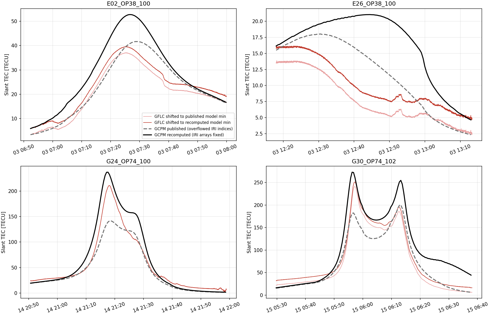

# Figure 3 GCPM recomputation

*Marco Guerra, 10 November 2026*

## Summary

The GCPM slant-TEC curves in Figure 3 (ION GNSS+ 2026 paper) are wrong. The LuGRE GFLC observations are not affected.

- **Cause.** The PyGCPM build that produced them reads IRI's solar-index file into arrays that are too small. For March 2025 dates this overflow makes IRI use IG12 ≈ 10 instead of ≈ 114. No error is raised.
- **Fix.** With the arrays enlarged, the corrected GCPM is 17–67% higher at the arc peaks. The end of the G30 arc is seven times higher (44.3 vs 6.1 TECU).
- **Independent check.** The corrected values agree with an independent recomputation by an external student to within 0.03 TECU at all 548 epochs.
- **Second bug.** PyGCPM's Python wrapper also passes the year (2025) to the Fortran core as the day of year. Every epoch was therefore computed for 25 January 2027 at the right UT. Reproducing both bugs gives the published values exactly (see [Second bug: wrong date](#second-bug-wrong-date)). The recomputation below fixes both.



*In each panel: dashed gray is the published GCPM and black is the recomputed GCPM. Light red is GFLC shifted to the published model minimum, red is GFLC shifted to the recomputed minimum (as in `src/plotting_func.py:92-96`).*

## How it was found

A student replicating Figure 3 sent a diagnostic package. Their two reference values:

| Epoch | Theirs | Our cache |
|---|---|---|
| E02, 2025-03-03 07:28:50 | 51.83 | 41.66 |
| G30, 2025-03-15 06:37:45 | 44.24 | 6.13 |

They traced the difference to the IRI index arrays and asked which build and `ig_rz.dat` we used.

## Root cause

`iri/irifun.for`, subroutine `tcon` (PyGCPM `c2c092a`, line 5784), declares:

```fortran
real ionoindx(722),indrz(722)
```

`tcon` reads all of `ig_rz.dat` into these arrays. The file we used (shared drive `GPCM/data/ig_rz.dat`, header `12,19,2025`, MD5 `f4a9fcfd26dd06a29ff1579e4e7c3f81`) covers 1958-01 to 2027-11, which is 841 values per series. gfortran does no bounds checking, and `-fno-automatic` makes the arrays static and adjacent.

- **What is read.** For March 2025 the index is 808, so `ionoindx(808)` reads into `indrz`. IG12 comes out at about 10 instead of 113; Rz12 stays correct.
- **Compilers checked.** The layout is the same with gfortran 11, 13 and 15.
- **Why the size fits our original file.** PyGCPM's bundled `ig_rz.dat` ends in 2009, which fits in 722 entries but gives NaN for 2025. That is why we replaced it, and replacing it is what triggered the overflow.

The Colab notebook `GCPM_vs_LuGRE.ipynb` cloned PyGCPM HEAD (`c2c092a`, unpatched), copied our `ig_rz.dat` and `ap.dat` into `iri/`, and ran plain `make`. The caches `results_*.npy` on the shared drive (`Iono_LuGRE/GPCM/cache_runs`) are dated 26 January 2026.

## Method

[`recompute_fig3.py`](recompute_fig3.py) keeps the published ray geometry and re-evaluates only the model:

1. It loads each cached arc. For each epoch it rebuilds the integration nodes from the cached GEO segment midpoints, using the repo's step table (`altitude_dependent_step_km`).
2. **Audit.** The cached densities integrated over the rebuilt segment lengths must reproduce the cached TEC within 0.01 TECU, otherwise the script stops. The largest error over all 548 epochs was below 0.001 TECU.
3. It converts the nodes GEO→SM with the repo's `convert_geo_to_sm_cartesian` (spacepy) and takes Kp from `extract_kp_index` (GFZ `Kp_ap_since_1932.txt`).
4. It evaluates GCPM at every node with a standalone driver ([`gcpm_driver/`](gcpm_driver/)). Then it integrates with the repo's trapezoid rule.

**Driver build.** `gcpm_driver/build.sh` takes a copy of PyGCPM's `c2c092a` sources and makes two fixes:

- it sets the `tcon` arrays to 1024 (or 722 for the control);
- it fixes an off-by-one `malloc` in `setLibPath`.

It then compiles with PyGCPM's own flags and links `drv_sm.c`. That C file calls the same `GCPM()` entry point PyGCPM uses, on SM coordinates in Earth radii. Rebuilt from scratch, the driver gives output bit-identical to the one used for these results.

The data directory contained the shared `ig_rz.dat` above and the student's `ap.dat` (MD5 `62d4a6e597f0bd408beefd9c8d5c8968`, the same size as the shared one).

## Validation

- **Against the student, per epoch.** Our corrected TEC matches their `author_grid_rebuilt_*.csv` at every epoch: the largest difference is 0.03 TECU (0.1%), and their Kp matches ours at every epoch.
  - E02, 07:28:50: 51.83 (theirs 51.83).
  - G30, 06:37:45: 44.26 (theirs 44.24).
- **Density profile.** Along the G30 06:37:45 ray, the largest difference from their per-step densities is 0.6%. Near 6,139 km altitude:

  | Source | Density (cm⁻³) |
  |---|---|
  | Ours | 46,841 |
  | Student | 46,866 |
  | Published cache | 4,610 |

## Results

All values in TECU.

| Arc | Published min / max | Recomputed min / max | Last epoch (published → recomputed) |
|---|---|---|---|
| E02_OP38_100 | 3.41 / 41.66 | 5.94 / 52.74 | 16.40 → 16.70 |
| E26_OP38_100 | 2.34 / 18.02 | 4.65 / 21.04 | 2.34 → 4.65 |
| G24_OP74_100 | 1.37 / 141.60 | 1.64 / 237.02 | 1.37 → 1.64 |
| G30_OP74_102 | 6.13 / 200.11 | 16.15 / 272.87 | 6.13 → 44.26 |

Fit to GFLC after the Figure 3 alignment (GFLC shifted so its minimum equals the model minimum). RMS is computed on the 30 s model grid using the nearest observation:

| Arc | GFLC shift, published | GFLC shift, recomputed | RMS, published | RMS, recomputed |
|---|---|---|---|---|
| E02 | −1.54 | +0.99 | 4.26 | 7.44 |
| E26 | −2.66 | −0.35 | 5.07 | 7.72 |
| G24 | −3.63 | −3.36 | 18.15 | 20.47 |
| G30 | −38.69 | −28.67 | 18.94 | 34.35 |

The misfit grows on all four arcs. The corrected model lies above the aligned GFLC at 79% of epochs on E02, 96% on E26 and 72% on G30, and at 46% on G24. On G30 the largest change comes after 06:20, during the plasmaspheric part of the pass. There GCPM now gives 44–90 TECU while the aligned GFLC falls from 49 to 16. Any statement in the paper that compares observed plasmaspheric content or refilling to GCPM should be re-checked against these curves.

Per-epoch values are in `gcpm_stec_recomputed_<arc>.csv`, and the metrics are in [`summary.csv`](summary.csv).

## Second bug: wrong date

`PyGCPM/GCPM.py` (at `c2c092a` and still at HEAD `79c36ed`) computes the day of year as:

```python
_dayno = np.int32(TT.DayNo(dates))
```

`DateTimeTools.DayNo` returns a `(year, doy)` tuple. The line therefore builds a 2×n array `[[2025, …], [74, …]]`, and ctypes passes the C library a pointer to its first row, which holds the years.

The C code builds `itime = year*1000 + doy = 2025*1000 + 2025 = 2027025`. The Fortran core reads that as year 2027, day 25. So every epoch of every arc was computed for 25 January 2027 at the correct UT. That affects:

- the IRI season;
- IRI's solar indices, which are the predicted values for January 2027;
- GCPM's internal SM→GEO conversion, which places the IRI part of the profile.

**Proof.** Running the standalone driver with year 2025 and day number 2025 reproduces both stored datasets exactly. G30 values in TECU:

| Epoch | Published cache | 722 build + wrong date | Colab, Nov 2026, fixed `ig_rz.dat` | 1024 build + wrong date |
|---|---|---|---|---|
| 06:02:15 | 126.94 | 126.94 | 158.48 | 158.48 |
| 06:29:45 | 17.36 | 17.36 | 22.17 | 22.17 |
| 06:37:45 | 6.13 | 6.13 | 7.61 | 7.60 |

The Colab rerun of 10 November 2026 used the trimmed `ig_rz.dat` (no overflow) but still had the date bug. Its rays are identical to the published ones (to within 3×10⁻⁵ km).

`recompute_fig3.py` and the student's adapter both pass the true day of year (74 for 15 March), which is why they agree with each other.

**Fix for the Colab notebook.** Add this line after cloning PyGCPM:

```bash
sed -i 's/np.int32(TT.DayNo(dates))/np.int32(TT.DayNo(dates)[1])/' PyGCPM/PyGCPM/GCPM.py
```

### Earlier control run (superseded)

Before the date bug was found, the same pipeline with the unpatched 722 build and the true date ([`control_unpatched_722/`](control_unpatched_722/)) was expected to reproduce the published cache, but it did not:

| Arc | Published max | Control max |
|---|---|---|
| E02 | 41.66 | 30.24 |
| E26 | 18.02 | 14.03 |
| G24 | 141.60 | 91.39 |
| G30 | 200.11 | 130.91 |

At the end of G30 the control is above the published value (14.04 vs 6.13), so the gap was not a constant scale factor. The wrong date explains all of it. The earlier conclusion that "the PyGCPM Python wrapper" was ruled out was wrong: that check had passed the true day of year, so it could not see the bug.

## Known limitations

- spacepy's IGRF coefficients end at 2025-01-01, so 2025 dates use that epoch for the SM dipole axis. The original pipeline had the same limitation, and the effect is negligible at this scale.
- IRI inside GCPM is IRI-2007, unchanged from the published run.
- **Not in the repo.** These inputs live outside the repo:
  - the cached rays (`results_*.npy`, shared drive);
  - the GFLC table (`obs_tab_new.csv`);
  - the Kp file;
  - `ig_rz.dat` and `ap.dat`.

## Reproducing

```bash
sh gcpm_driver/build.sh <copy of PyGCPM c2c092a libgcpm sources> 1024
python recompute_fig3.py gcpm_driver/drv_sm1024 <libpath with iri/ig_rz.dat, iri/ap.dat, ...>/ <dir with results_*.npy> <obs_tab_new.csv> <Kp_ap_since_1932.txt> <out_dir>
```

Python needs numpy, pandas, matplotlib and spacepy. A full run of the four arcs took about 6 hours on a laptop (with the control running at the same time), because the driver is started once per epoch.

**Through the notebook (v0.2.0 onward).** The repository's `GCPM_vs_LuGRE.ipynb` and `requirements.txt` now pin the fixed fork [mguerra96/PyGCPM@330bfc4](https://github.com/mguerra96/PyGCPM/commit/330bfc4e48351bd3f6796569f6ea6ce2c664db9b), which contains both fixes plus the `setLibPath` one. Its Python wrapper reproduces this recomputation exactly on the two key rays:

| Ray | Fork wrapper | This recomputation |
|---|---|---|
| E02 07:28:50 | 51.8312 TECU | 51.8312 TECU |
| G30 06:37:45 | 44.2577 TECU | 44.2577 TECU |

The notebook writes to new folders (`cache_runs_v0.2/`, `GCPM_Plots_v0.2/`), so it never reloads the old caches or overwrites the old plots.

## Files

| File | Content |
|---|---|
| `recompute_fig3.py` | recomputation script |
| `gcpm_driver/` | driver source and build script |
| `gcpm_stec_recomputed_<arc>.csv` | time, Kp, published TEC, recomputed TEC, audit error, number of steps |
| `summary.csv` | per-arc metrics |
| `figure3_gcpm_recomputed.png` | figure above |
| `control_unpatched_722/` | same outputs from the unpatched build (true date) |
